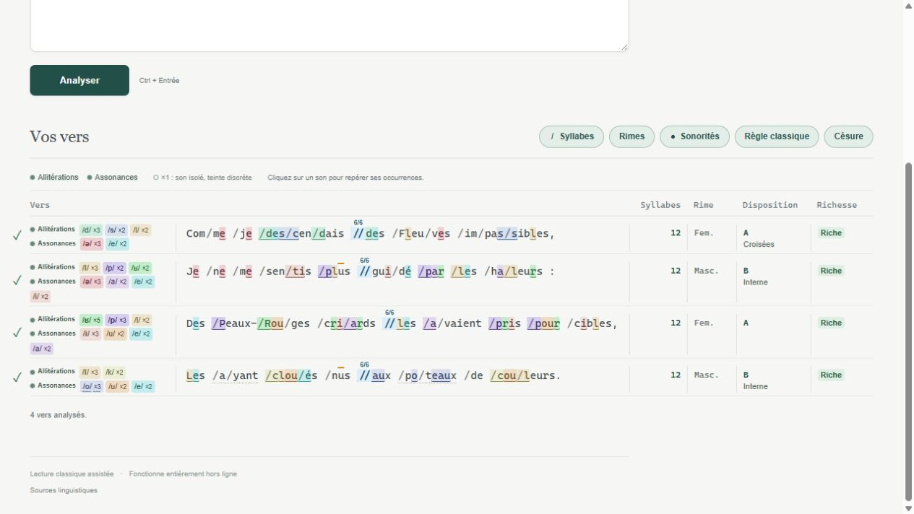
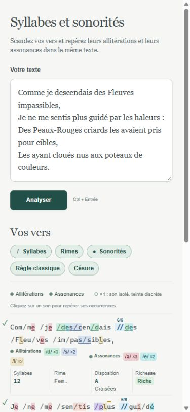
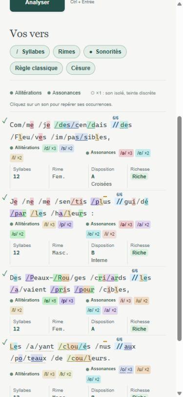

# Syllabes et sonorités

**Un atelier de lecture poétique du français, autonome et utilisable hors ligne.**  
**A self-contained tool for reading and analysing French poetry, available offline.**

[**Ouvrir l’application · Open the app**](https://heroless-code.github.io/syllabes-et-sonorites/) · [Télécharger le projet · Download](https://github.com/Heroless-code/syllabes-et-sonorites/archive/refs/heads/main.zip)

[ Français](#français) · [ English](#english)

##  Français

Collez un poème et cliquez sur **Analyser**. Activez les outils qui vous intéressent pour explorer le texte dans une seule vue.

Le texte d’exemple est **Le Bateau ivre**, d’Arthur Rimbaud, dans l’édition des *Œuvres complètes* de 1942 sur Wikisource. [Copier les 100 vers](docs/examples/le-bateau-ivre.txt) · [Lire la source](https://fr.wikisource.org/wiki/%C5%92uvres_compl%C3%A8tes_%28Rimbaud%29/Bateau_ivre)

| Fonction | Dans l’application |
| --- | --- |
| **Syllabes** | Affiche les frontières / et le compte par vers, avec une fourchette lorsque plusieurs comptes sont possibles. |
| **Rimes** | Affiche le genre **Fem. / Masc.**, la lettre de chaque famille, la disposition et la richesse. |
| **Disposition** | Reconnaît les rimes plates, croisées, embrassées et redoublées. Les lettres restent cohérentes dans tout le poème. |
| **Richesse** | Distingue les rimes pauvres, suffisantes et riches grâce à des couleurs. |
| **Sonorités** | Repère les allitérations et les assonances. Cliquez sur un son pour isoler ses occurrences, puis pour masquer ou rétablir sa couleur. |
| **Césure** | Propose des coupes en // bleu clair et écrit le découpage au-dessus, comme 6/6 ou 4/4/4. En dernier recours, elle choisit la frontière entre mots la plus proche de la moitié. |
| **Rimes internes** | Indique **Interne** et trace du doré au-dessus des lettres qui portent les sons communs à deux césures, dans une fenêtre de huit vers d’une strophe. |
| **Règle classique** | Affiche une coche ou une croix pour les deux contrôles définis dans la notice, concernant les finales en **-ées** et le **e muet après voyelle**. |
| **Strophes et mobile** | Une ligne vide sépare les strophes. Sur téléphone, les mesures passent sous chaque vers. |

### Utilisation

1. [Ouvrez l’application](https://heroless-code.github.io/syllabes-et-sonorites/) ou téléchargez le projet.
2. Pour une utilisation locale, décompressez le ZIP et ouvrez **index.html** dans un navigateur récent.
3. Collez vos vers, puis cliquez sur **Analyser** ou utilisez **Ctrl + Entrée**.

Le texte et les lexiques sont traités sur votre appareil. Le HTML local fonctionne sans installation et sans connexion. Les options se combinent librement.

Les césures, les prononciations et certains comptes sont des propositions de lecture. La **Règle classique** applique les deux critères documentés. Une vérification littéraire du poème reste à la charge du lecteur.

### Sur téléphone

| Saisie | Résultats |
| --- | --- |
|  |  |

[Lire les précisions en français](docs/precisions.fr.md)

##  English

Paste a French poem and select **Analyser**. Combine the tools to explore syllables, rhymes and repeated sounds in the same text. The application interface is in French.

The example poem is **Le Bateau ivre** by Arthur Rimbaud, from the 1942 edition of his *Œuvres complètes* on Wikisource. [Copy the complete 100-line poem](docs/examples/le-bateau-ivre.txt) · [Read the source](https://fr.wikisource.org/wiki/%C5%92uvres_compl%C3%A8tes_%28Rimbaud%29/Bateau_ivre)

| Feature | What it shows |
| --- | --- |
| **Syllables** | / syllable boundaries and a count for each line, including a range when multiple counts are possible. |
| **Rhymes** | **Fem. / Masc.** endings, rhyme-family letters, rhyme schemes and rhyme richness. |
| **Rhyme schemes** | Paired, alternating, enclosed and repeated rhymes. Family letters remain consistent throughout the poem. |
| **Rhyme richness** | Colour-coded poor, sufficient and rich rhymes, based on shared final sounds. |
| **Sound patterns** | Alliteration and assonance. Select a sound to focus its occurrences, then hide or restore its colour. |
| **Caesura** | Estimated light-blue // cuts with the chosen division above them, such as 6/6 or 4/4/4. When the estimate is uncertain, the nearest word boundary to the midpoint is used. |
| **Internal rhymes** | An **Interne** label and gold marks over matching letters at caesuras in two different lines, within an eight-line window in a stanza. |
| **Classical checks** | A tick or cross for the two documented checks involving **-ées** endings and a **mute e after a vowel**. |
| **Stanzas and mobile** | Blank lines separate stanzas. On phones, measurements move below each line. |

### Getting started

1. [Open the application](https://heroless-code.github.io/syllabes-et-sonorites/) or download the project.
2. For offline use, unzip the project and open **index.html** in a recent browser.
3. Paste your poem and select **Analyser**, or press **Ctrl + Enter**.

Text processing and dictionaries stay on your device. The local HTML works without installation or an internet connection. Caesuras, pronunciations and some counts are reading suggestions that benefit from human review.

### Screenshots

[Read the English notes](docs/precisions.en.md)

## Development

Node.js 22 or later is used to build and test the project.

<pre><code>node scripts/build.mjs
node tests/regression.mjs</code></pre>

The project uses bundled sources and standard Node.js modules. **index.html** is the ready-to-use build. Edit the sources in **src/**, then rebuild.

The regression suite covers source-text preservation, independent controls, rhyme schemes, richness, internal-rhyme alignment, short and odd-length lines, caesura divisions, and changed-input handling. Earlier development checks also exercised 158 poetic pages and the preface of Victor Hugo’s *Les Contemplations* on Wikisource.

## Sources

The linguistic data include Lexique 4.1 and a selected part of GLÀFF 1.2.2. Attribution and data licences are detailed in [THIRD_PARTY_NOTICES.md](THIRD_PARTY_NOTICES.md) and inside the application.
